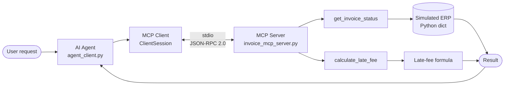
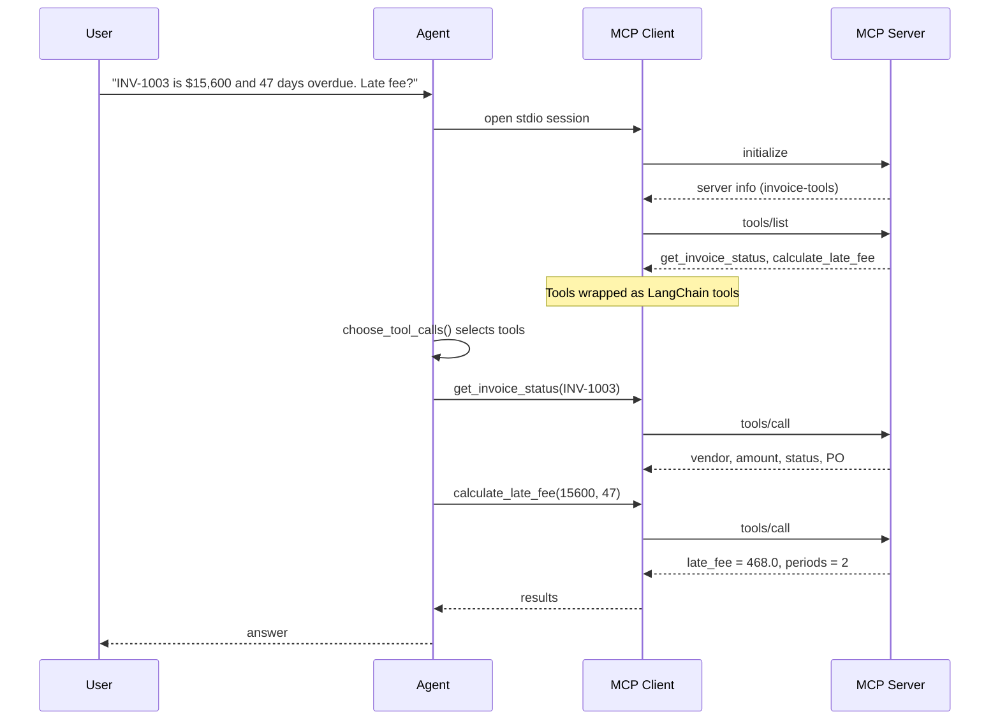
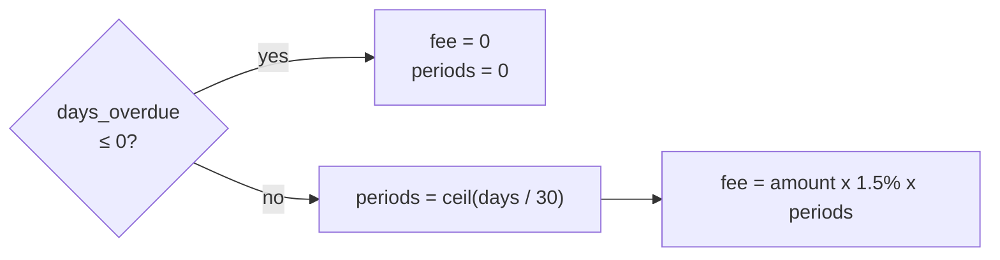
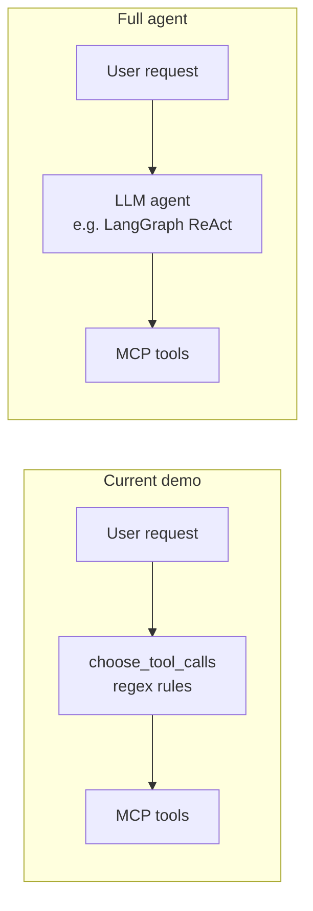

# MCP Proof of Concept: Invoice Tools with LangChain

A minimal, runnable demo of the **Model Context Protocol (MCP)**. An agent starts an MCP server over stdio, discovers its tools at runtime, wraps them as LangChain tools, and calls them to answer invoice questions.

Practical proof of concept for **Part B: MCP Exploration**.

| | |
|---|---|
| **Language** | Python 3.10+ |
| **Transport** | stdio (JSON-RPC 2.0) |
| **API key needed** | No |
| **Runs offline** | Yes |

---

## 1. Architecture



The client launches the server as a **subprocess**. You never start the server yourself.

---

## 2. Message flow



---

## 3. Tools

| Tool | Input | Output |
|---|---|---|
| `get_invoice_status` | `invoice_id: str` | `{found, invoice_id, vendor, amount, status, po_number}` or `{found: false, invoice_id}` |
| `calculate_late_fee` | `amount: float`, `days_overdue: int` | `{late_fee, periods_overdue}` |

### Late-fee rule



Example: 47 days gives 2 started periods, so $15,600.00 x 1.5% x 2 = **$468.00**.

### Simulated ERP data

| Invoice | Vendor | Amount | Status | PO |
|---|---|---|---|---|
| `INV-1001` | Acme Supplies | 4,200.00 | MATCHED | PO-77 |
| `INV-1002` | Beacon Freight | 980.50 | MISMATCH | PO-81 |
| `INV-1003` | Coastal Materials | 15,600.00 | APPROVED | PO-92 |

---

## 4. Project structure

```
.
├── invoice_mcp_server.py   MCP server (FastMCP), exposes 2 tools
├── agent_client.py         Agent + MCP client + LangChain wrapping
├── make_diagrams.py        Generates PNG diagrams (matplotlib)
├── requirements.txt        mcp, langchain-mcp-adapters, matplotlib
├── run_output.txt          Captured output of a successful run
├── diagram_architecture.png
└── diagram_workflow.png
```

---

## 5. Run it

**Windows (PowerShell)**

```powershell
python -m venv .venv
.venv\Scripts\activate
pip install -r requirements.txt
python agent_client.py
```

**macOS / Linux**

```bash
python -m venv .venv
source .venv/bin/activate
pip install -r requirements.txt
python agent_client.py
```

Optional: `python make_diagrams.py` regenerates the PNG diagrams.

### Expected output (abridged)

```
[MCP] Connected to server: invoice-tools v<sdk version>
[MCP] Discovered 2 tool(s) via tools/list:
       - get_invoice_status: Look up the current workflow status of an invoice by its ID.
       - calculate_late_fee: Calculate a late-payment fee for an overdue invoice.
[LangChain] Wrapped 2 MCP tool(s) as LangChain Tool objects
[AGENT] Decided to call 2 tool(s): ['get_invoice_status', 'calculate_late_fee']
[MCP] --> tools/call  name=calculate_late_fee  arguments={"amount": 15600.0, "days_overdue": 47}
[MCP] <-- result: {"late_fee": 468.0, "periods_overdue": 2}
```

Full run: see `run_output.txt`.

---

## 6. What is real and what is simulated

| Component | Status |
|---|---|
| MCP server (FastMCP), stdio transport | Real |
| `initialize`, `tools/list`, `tools/call` over JSON-RPC 2.0 | Real |
| MCP tools wrapped as LangChain tools | Real |
| ERP data | **Simulated** (in-memory dict) |
| Tool selection ("agent brain") | **Simulated** (regex rules, not an LLM) |

### Limitation: the agent is not an LLM

`choose_tool_calls()` in `agent_client.py` uses regular expressions to pick tools. It stands in for an LLM so the demo runs offline and deterministically.



To upgrade, pass `lc_tools` to an LLM-driven agent instead of calling `choose_tool_calls()`. The server needs no changes. Check the current LangChain/LangGraph docs for exact imports, as they change between versions.

---

## 7. Possible extensions

- [ ] Add an MCP **resource** (e.g. `erp://invoices/{id}`) and an MCP **prompt** to cover all three primitives
- [ ] Replace the in-memory dict with a real database
- [ ] Serve over Streamable HTTP with authorisation instead of stdio
- [ ] Add input validation and automated tests

---

## References

- Model Context Protocol: https://modelcontextprotocol.io
- MCP Python SDK: https://github.com/modelcontextprotocol/python-sdk
- LangChain MCP adapters: https://github.com/langchain-ai/langchain-mcp-adapters
